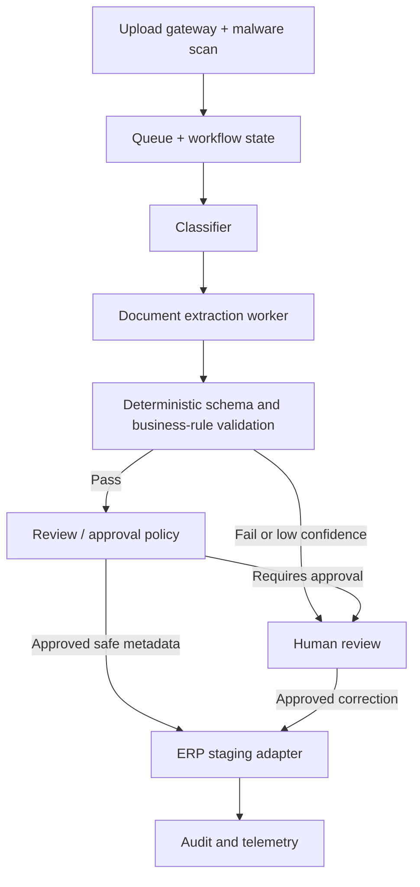

# Case Study 02 — Multi-Agent Document Intake and Review

**Status:** Architecture-only reference design. No working implementation or client deployment is claimed.

## Client scenario
A fictional enterprise processes 12,000 supplier onboarding documents per month. Staff manually classify documents, extract required fields, reconcile inconsistent records, and route exceptions for review.

## Requirements
- Classify invoices, tax forms and supplier agreements.
- Extract fields with source-page citations and confidence scores.
- Validate against schema and approved vendor records.
- Escalate conflicting or sensitive changes for human approval.
- Retain an auditable chain of custody; no autonomous payment execution.

## Proposed design

## Architecture decisions
1. **Do not use agents for deterministic validation.** Use explicit schema checks, field constraints and referential integrity.
2. **Specialize by capability, not by buzzword.** Classification and extraction may use distinct model prompts/workers; workflow state is controlled centrally.
3. **Human approval before durable changes.** An agent cannot create or update payment instructions.
4. **Idempotent operations.** Document hash + workflow ID prevents duplicate processing after retries.
5. **Document provenance.** Extracted fields link to page/section evidence; confidence alone does not prove correctness.

## Failure and recovery
- Corrupt files → quarantine, alert and manual processing.
- Extraction timeout → bounded retry with backoff; dead-letter queue after threshold.
- Conflicting vendor data → manual reconciliation.
- Duplicate submission → idempotent return of existing workflow result.
- ERP unavailable → staged outbox, retry and reconciliation; no blind re-submission.

## Security and privacy
Tenant-scoped storage and queue identities; malware scanning; content isolation against prompt injection; encryption; retention policy; redacted telemetry; human approval for vendor banking changes.

## Tradeoffs
| Alternative | Advantage | Concern |
|---|---|---|
| Single prompt extracts everything | Low orchestration cost | Poor observability and weak validation |
| Specialized workers + deterministic validation (chosen) | Explicit evidence and review gates | More components and operational complexity |
| Fully autonomous agent network | Flexible | Unnecessary authority and unpredictable costs |

## Illustrative evaluation plan (targets, not measured)
- 98% document classification accuracy on labeled holdout set.
- 95% field-level extraction F1, stratified by document type.
- 100% manual review for bank-account changes.
- 0 duplicate ERP writes in retry tests.
- Measured cost/document, p95 processing time, exception rate.

## What remains to implement
OCR/document parsing, durable state, queue, ERP adapter, approval UI, labeled evaluation corpus, operational telemetry and load tests.

