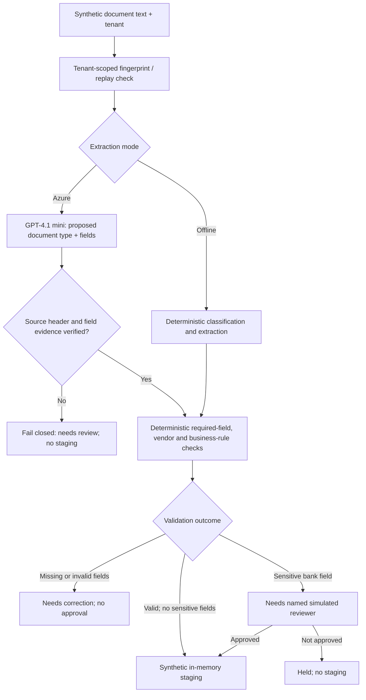

# Project 02 — Intelligent Document Processing

**Status:** Executable synthetic reference prototype with deterministic offline mode and optional live Azure GPT-4.1 mini classification/extraction, Streamlit workspace and automated tests. No OCR, Azure Document Intelligence, durable queue or real ERP is connected.

## Client scenario

A fictional supplier onboarding team processes invoices, tax forms and agreements. The objective is to minimize manual handling without allowing unvalidated extraction or sensitive banking changes to flow into enterprise systems.

## Implemented workflow



### Optional Azure mode

Choose **AI-assisted · Azure Foundry** in Document execution. The shared Project 01 .env config is used. GPT-4.1 mini proposes document type and JSON fields. Python checks that every returned field exactly matches the original labeled source line, checks classification against the document header, preserves deterministically grounded labeled fields (including bank details), and runs the same validation/review/staging gates. A malformed response, ungrounded field or model outage results in **needs_review** with no staging. Offline and Azure document fingerprints are separated. No OCR or live supplier integrations are implied.

### Working capabilities

- Three document types: **invoice**, **tax form**, **supplier agreement**.
- Five synthetic text fixtures and custom text input.
- Structured field extraction with line-number evidence.
- Required-field validation, synthetic vendor allowlist, amount/currency/date checks.
- Sensitive bank-account fields held for named simulated reviewer approval.
- Missing/invalid data cannot be approved without correction.
- Tenant-scoped SHA-256 document fingerprints, in-memory idempotency, and staged-record counts.
- Structured audit events and downloadable JSON evidence.
- Automated offline regression tests.

**Observed live acceptance:** The valid Azure invoice staged with source-line evidence. The Azure supplier agreement extracted vendor ID, effective date and bank account, then returned `needs_review` with `sensitive_bank_details_require_review` and line evidence. These are user-observed synthetic runs, not measured extraction accuracy.

### Demo walkthrough

Select **02 · Intelligent Document Processing** in Streamlit. Run **Valid invoice** (staged), run it again (duplicate, not staged twice), run **Missing invoice amount** (needs review and cannot be approved), then run **Agreement requiring review** (approval required; named simulated reviewer may stage it).

```powershell
.\.venv\Scripts\python.exe -m unittest tests.test_document_processing -v
.\.venv\Scripts\python.exe -m streamlit run dashboard.py
```

## Trust boundaries and limitations

The intake engine accepts **plain synthetic text**, not uploaded PDFs or scanned images. It does not perform OCR, malware scanning, model confidence scoring, or real source-page citations; evidence is a **source-line reference**. Tenant and reviewer identities are simulated, not verified. State, approvals, audit and staging are **in memory only**, not durable or transactionally safe. No ERP API or payment write exists.

### Enterprise extension

Real deployment would require secure file ingress, malware scanning, Azure AI Document Intelligence or equivalent OCR/extraction, versioned schemas, model-quality evaluation, durable queues and idempotent outbox, real identity/approval workflows, ERP staging integration, retention/redaction, and measured processing quality and cost.

**Illustrative targets, not measured:** 98% classification accuracy, 95% field F1, zero duplicate writes in retry tests, mandatory human review for bank-detail changes, and p95 processing latency within an agreed SLO.

[Source](../src/document_processing/pipeline.py) · [Tests](../tests/test_document_processing.py) · [Portfolio README](../README.md)
