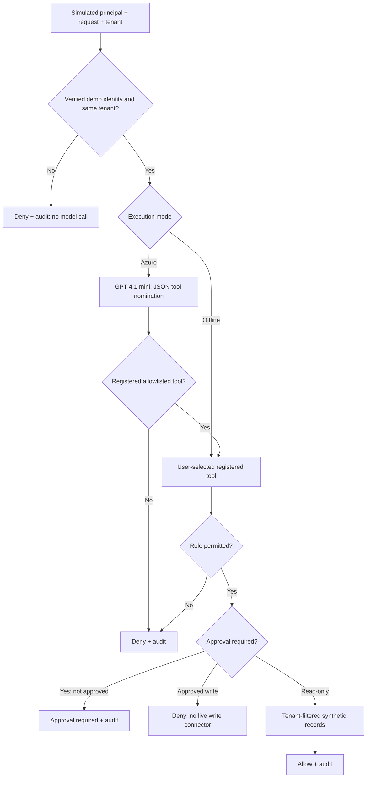

# Project 03 — Governed Enterprise Agent Platform

**Status:** Executable synthetic governance prototype with deterministic offline mode and optional Azure GPT-4.1 mini natural-language tool routing. No real IAM, live enterprise tools or deployed Azure infrastructure.

## Client scenario

A fictional multinational wants a reusable agent tool control plane for HR, finance and IT. Tool execution must honor simulated identity claims, tenant boundaries, roles and approval requirements. This prototype **simulates** verification and demonstrates the authorization decision chain.

## Implemented architecture



### Optional Azure mode

Choose **AI tool selection · Azure Foundry** in Governed tool execution. Submit a synthetic natural-language request. The model can nominate only a registered tool name, with no account, tenant or authorization arguments. Unverified and cross-tenant requests are rejected before inference. After selection, Python independently enforces role permissions and approval gates; payment writes remain disconnected. Unsupported or malformed model output fails closed. The same Project 01 .env configuration is reused.

### Working capabilities

- Four registered tools: HR policy lookup, finance report lookup, IT ticket lookup, and approval-gated vendor payment update.
- Six synthetic principals across two tenants, with different roles and a simulated verification flag.
- Default-deny unregistered tools, unverified callers, cross-tenant requests and missing roles.
- Tenant-filtered synthetic read-only records.
- Request-scoped, tenant-scoped simulated approval decisions.
- Explicit refusal to execute payment writes **even after approval**.
- In-memory audit events with correlation IDs and JSON export.
- Automated negative tests for isolation, approval and unknown tools.

### Demo walkthrough

Select **03 · Enterprise Agent Platform** in Streamlit:

1. HR reader, tenant A, `hr_policy_lookup`, tenant A → allowed; only HR record returned.
2. HR reader, tenant A, `finance_report_lookup`, tenant A → denied by role.
3. Finance reader, tenant A, `finance_report_lookup`, tenant B → denied cross-tenant.
4. Unverified caller, finance tool → denied.
5. Finance admin, vendor payment update → approval required. Switch to Approver, record approval for the same request ID, then retry as Finance admin → still denied because writes are intentionally disconnected.

```powershell
.\.venv\Scripts\python.exe -m unittest tests.test_enterprise_platform -v
.\.venv\Scripts\python.exe -m streamlit run dashboard.py
```

## Design tradeoffs and production gaps

This is a **governance control-plane simulation with optional model-assisted routing**, not a complete autonomous agent runtime. `verified=True` is a synthetic test flag, **not JWT verification**. Audit records and approvals are in memory, not immutable. The data catalog is a static fixture, not Azure AI Search. Optional Azure GPT-4.1 mini model inference is integrated for tool selection. Managed identity, service mesh, real tool APIs and production deployment are not integrated.

For enterprise deployment, integrate OIDC/Entra token validation, downstream policy enforcement, tenant-scoped managed identities, centralized tool registry and approval workflow, real retrieval ACLs, redacted audit traces, CI/CD, security incident playbooks, and measured availability/latency/cost.

**Illustrative targets, not measured:** 99.9% availability, zero cross-tenant leaks on a defined negative suite, full high-risk tool audit coverage and per-request cost attribution.

[Source](../src/enterprise_platform/governance.py) · [Tests](../tests/test_enterprise_platform.py) · [Portfolio README](../README.md)
