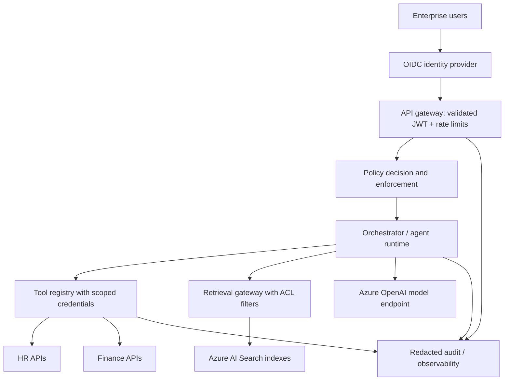

# Case Study 03 — Governed Enterprise Agent Platform

**Status:** Architecture-only reference design. No deployed Azure infrastructure is claimed.

## Client scenario
A fictional multinational wants shared agent infrastructure for HR, finance and IT while enforcing strict department/tenant boundaries, standardized tooling, and measurable operating costs.

## Reference architecture

## Architecture decisions
- **Verified identity:** Gateway validates issuer, audience, signature, expiry, tenant and scopes. User text never determines identity.
- **Authorization in each tool:** Policy enforcement at gateway and tool adapter; no model-generated authority.
- **Retrieval isolation:** Tenant and document ACL filters enforced server-side before results reach the model.
- **Least privilege:** Per-tool managed identities and allowlisted operations; no shared unrestricted service account.
- **Human-in-the-loop:** Durable approval for high-risk writes; audit who approved what.
- **Observability:** Structured trace IDs, cost/latency per request, model/tool error rates; redact PII and secrets.
- **Change management:** Version prompts, tools, models and retrieval indexes; staged rollout and rollback gates.

## Threat scenarios
1. HR employee asks finance agent for payroll of another employee → denied by tool and retrieval ACLs.
2. Malicious PDF instructs model to exfiltrate data → retrieved content treated as untrusted; tools cannot call unapproved endpoints.
3. Compromised tool credential → revoke managed identity scope, rotate secrets if applicable, quarantine tool and review audit trail.
4. Cross-tenant leak → disable affected route, preserve evidence, assess impact, notify according to obligations, remediate and retest before restoring.

## Alternatives and tradeoffs
| Choice | Benefit | Cost/risk |
|---|---|---|
| Fully managed agent platform | Faster setup | Vendor constraints and control boundaries |
| Fully custom runtime | Deep flexibility | High operations burden |
| Hybrid managed services + explicit orchestration (chosen) | Balances delivery speed and control | Integration complexity |

## Nonfunctional design targets (unmeasured)
Availability SLO 99.9%; p95 FAQ response under 5 seconds; zero unauthorized data retrievals in agreed negative test suite; measurable cost per resolved task; 100% traceability of high-risk tool calls.

## Production readiness checklist
OIDC identity provider integration, tenant-aware API authorization, policy engine, secret management, CI/CD, infrastructure-as-code, disaster recovery, redacted logging, adversarial evaluation, accessibility, data residency and compliance sign-off.

## Status disclosure
This is a proposed design, not proof that these security or reliability controls have been deployed or tested.

