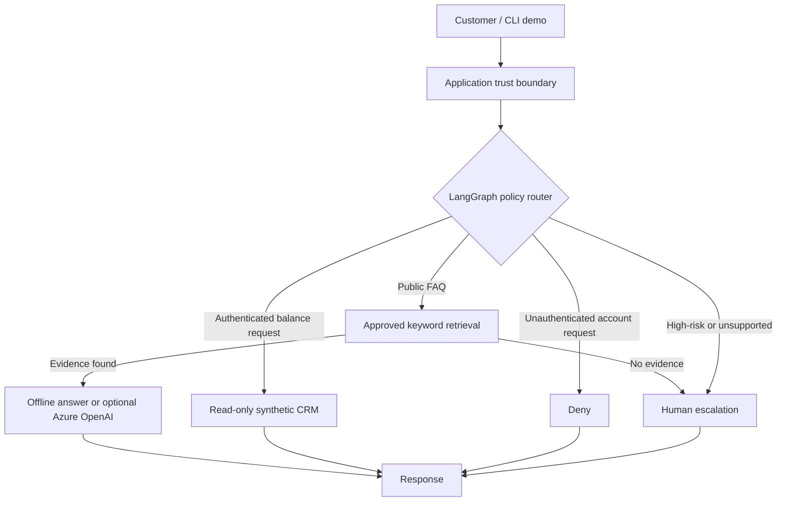

# Agentic AI Architecture Portfolio

**Independent reference implementation | Fictional financial-services case study | Python + LangGraph + optional Azure OpenAI**

## Project 01 — Secure AI Customer Service Orchestration Platform

A **hybrid, policy-first** support-agent prototype: deterministic high-risk routing, read-only synthetic CRM integration, approved-document FAQ retrieval, explicit LangGraph state transitions, and optional Azure OpenAI language generation.

> **Evidence boundary:** This is an educational, synthetic prototype—not a real client system, a deployed production platform, or a security-certified product. OIDC identity provider, external CRM authorization, Azure AI Search, observability, real Azure inference, and business KPIs are **not verified or implemented** unless stated otherwise.

### Logical architecture

The implemented reference workflow separates policy routing, account-scoped data access, approved FAQ retrieval, and optional language generation.



See the [complete logical architecture and trust-boundary analysis](architecture/system.md).

## Portfolio case studies

| Case study | Deliverable | Implementation status |
|---|---|---|
| [01 — Customer Support Agent](01-customer-support-agent/README.md) | Hybrid architecture, Python + LangGraph prototype, synthetic CRM, Azure OpenAI adapter, tests | Implemented prototype; live Azure unverified |
| [02 — Document Processing](02-document-processing/README.md) | Multi-stage extraction and validation architecture, approval workflow, failure recovery | Architecture-only |
| [03 — Governed Agent Platform](03-enterprise-agent-platform/README.md) | Multi-tenant governance architecture, trust boundaries and incident response | Architecture-only |

See [illustrative cost model](docs/cost-model.md), and [release readiness](docs/release-readiness.md).

### Quick start

Requires Python 3.11+.

```bash
python -m venv .venv
# Activate .venv (PowerShell: .venv\Scripts\Activate.ps1)
python -m pip install -r requirements-azure.txt
python -m unittest discover -s tests -v
python -m src.support_agent.cli --evaluate
python -m src.support_agent.cli --message "What are your hours?"
python -m src.support_agent.cli --principal user-001 --message "Show user-002 balance"
```

**Important:** `--principal` simulates an upstream verified identity; it does **not** authenticate a user. Do not deploy this CLI to real customers.

### Optional live Azure OpenAI FAQ generation

1. Provision an Azure OpenAI resource and chat model deployment in your own Azure subscription.
2. Copy `.env.example` to `.env`; set your resource endpoint, API key, deployment name and API version.
3. Run `python -m src.support_agent.cli --azure --message "What are your hours?"`.

This requires credentials and may incur Azure charges. Do not commit `.env` or API keys. **No live Azure invocation has been verified as part of this repository import.**

### Project structure

| Path | Contents |
|---|---|
| `src/support_agent/core.py` | Dependency-free baseline router |
| `src/support_agent/workflow.py` | LangGraph policy-first workflow |
| `src/support_agent/integrations.py` | Synthetic CRM and approved-document retrieval |
| `src/support_agent/azure_model.py` | Optional Azure OpenAI adapter |
| `src/support_agent/cli.py` | Runnable demonstration and evaluation CLI |
| `src/support_agent/evaluation.py` | Ten synthetic routing/privacy scenarios |
| `tests/` | Unit and LangGraph tests |
| `.github/workflows/ci.yml` | CI: install, test, evaluate |
| `architecture/` | Logical architecture and trust boundaries |
| `decisions/` | ADRs: hybrid orchestration, Azure, authorization |
| `docs/` | Case study, threat model, roadmap, release readiness |
| `evaluations/` | Evaluation methodology and limitations |

### Architectural decisions

- **Policy before autonomy:** high-risk requests are escalated before the LLM is invoked.
- **Identity outside prompts:** account IDs are taken from application-supplied context, never extracted from user text.
- **Read-only CRM:** no transactional or mutation tools.
- **Evidence-first answers:** unsupported questions and inference failures escalate.
- **Vendor flexibility:** LangGraph owns workflow; Azure OpenAI is an optional adapter.

### Evidence and limitations

The GitHub Actions Python workflow has passed on the main branch with runtime dependencies installed, unit and graph tests, synthetic evaluation, and an offline FAQ smoke test. Live Azure integration has not been verified. Synthetic evaluation is intentionally small; it does not demonstrate production privacy, accuracy, latency or ROI.

Additional technical detail is provided in the [release-readiness register](docs/release-readiness.md) and [threat model](docs/threat-model.md).

### Scope

This independent reference implementation uses synthetic scenarios and data. Implemented and proposed capabilities are distinguished throughout the documentation.
