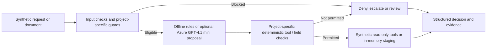

# Enterprise AI Agent Architecture Portfolio

[](https://github.com/n-neykov/agentic-ai-architecture-portfolio/actions/workflows/ci.yml)

**Three executable synthetic reference projects** | Python 3.11+ · LangGraph · Azure AI Foundry / GPT-4.1 mini · Streamlit

An independent architecture and engineering portfolio exploring a practical enterprise design question: **where should an LLM make decisions, and where must deterministic software retain authority?** The projects share one local Streamlit dashboard and demonstrate bounded model-assisted routing, explicit policy decisions, source-grounded document intake, and tenant-aware tool governance. They are **not production deployments**.

## See the systems in action

The images below are **actual local Streamlit executions** using synthetic identities, documents and records—not design mockups. [View all eight execution and verification results](docs/demonstration-evidence.md).

### 01 · Bounded AI customer support

**Azure GPT-4.1 mini · Approved multi-intent execution · Two completed model calls**

A fictional customer asks for business hours and their own balance. Deterministic policy permits the request, and the model nominates two allowed read-only tools. The dashboard shows the selected tools, FAQ evidence and synthetic $120 balance.

[](docs/demonstration-evidence.md#project-01--secure-customer-service)

[View the cross-account denial with zero model calls](docs/demonstration-evidence.md#cross-account-request-denied-before-inference) · [Project architecture](01-customer-support-agent/README.md)

### 02 · Evidence-grounded document intake

**Azure-assisted extraction · Deterministic validation · Human-review gate**

A synthetic supplier agreement yields source-line-grounded fields but is held at `needs_review` because it contains bank-account details. No ERP update or external write occurs.

[](docs/demonstration-evidence.md#project-02--intelligent-document-processing)

[View the successfully staged invoice](docs/demonstration-evidence.md#valid-synthetic-invoice-staged) · [Project architecture](02-document-processing/README.md)

### 03 · Governed enterprise tool execution

**Synthetic tenant isolation · Server-side authorization · Pre-inference denial**

A finance-reader identity belonging to tenant A requests tenant B. The application denies the request with `cross_tenant_access` and `model_called=False`, without returning tenant-B records.

[](docs/demonstration-evidence.md#project-03--governed-enterprise-agent-platform)

[View the authorized tenant-A tool execution](docs/demonstration-evidence.md#authorized-tenant-a-read) · [Project architecture](03-enterprise-agent-platform/README.md)

---

## Explore the projects

| Project | Architectural question | What runs | Demonstrated decision |
|---|---|---|---|
| **[01 · Secure Customer Service](01-customer-support-agent/README.md)** | How do we bound an AI support agent before it accesses private data? | Deterministic LangGraph baseline and optional Azure-assisted multi-intent workflow; 12 synthetic FAQs and scoped balances | Known high-risk and cross-account requests stop before inference |
| **[02 · Intelligent Document Processing](02-document-processing/README.md)** | How can AI-assisted extraction remain verifiable and reviewable? | Offline extraction or Azure-proposed fields, exact labeled-line evidence, validation, in-memory staging | Bank-account data triggers simulated human review |
| **[03 · Governed Enterprise Agent Platform](03-enterprise-agent-platform/README.md)** | How do we separate model tool selection from execution authority? | Registered synthetic tools, role/tenant checks, optional Azure routing, simulated approvals | Cross-tenant Azure requests are denied before model invocation |

**[Demonstration evidence](docs/demonstration-evidence.md)** · **Start here:** [Project 01 architecture](architecture/system.md) · [Project 02 decision flow](02-document-processing/README.md#implemented-workflow) · [Project 03 governance flow](03-enterprise-agent-platform/README.md#implemented-architecture) · [Technical review and residual risks](docs/final-technical-review.md)

## Engineering evidence

| Evidence | What it establishes | Verification status |
|---|---|---|
| **97/97 automated tests passed (locally verified, 2026-10-22)** | Python unit, workflow and mocked-model regression coverage | Screenshot evidence shows **Ran 97 tests … OK**, including malformed-bank regressions; local run, not independently reproduced in CI. |
| **10-scenario offline evaluation** | Deterministic Project 01 routing against known synthetic scenarios | Screenshot evidence shows **10/10 passed** in the offline baseline evaluation |
| **Live Azure demonstration: P1** | Bounded multi-intent support, synthetic own-account reads, cross-account and high-risk preflight | observed in local live-Azure demonstrations, not an Azure model benchmark |
| **Live Azure demonstration: P2** | Invoice staged with evidence; supplier agreement extracted with evidence and held for bank-detail review | observed in local live-Azure demonstrations, not measured extraction accuracy |
| **Live Azure demonstration: P3** | Finance tool allowed for tenant A; tenant B request denied with `model_called=false` | observed in local live-Azure demonstrations, not verified production IAM |
| **GitHub Actions** | Compile, unit tests, deterministic evaluation and offline CLI smoke test on pushes/PRs | [Inspect actual workflow results](https://github.com/n-neykov/agentic-ai-architecture-portfolio/actions/workflows/ci.yml); badge is live, not a claimed result |

The test count is not a performance score. Tests use synthetic fixtures and fake models; **live Azure acceptance and automated regression coverage are separate forms of evidence**.

## Architecture principles

| Design choice | Why it matters | Explicit boundary |
|---|---|---|
| **Deterministic gates before inference** | Known prohibited requests are rejected without asking a model to authorize them | Pattern matching is incomplete and is not production-grade IAM |
| **Model nominations, server-owned execution** | The LLM selects from known options; Python owns tool arguments and permission checks | No unrestricted tool calling or autonomous multi-agent planner |
| **Grounded document fields** | Proposed fields must match labeled source text; business rules run after extraction | Not OCR, general PDF understanding, or a measured document-AI model |
| **Fail-closed outcomes** | Invalid inference or unsupported operations cannot stage records or execute tools | Failures may increase manual review and require operational handling |
| **Synthetic tenant and identity controls** | Makes role, scope and approval tradeoffs demonstrable | No real OIDC, enterprise data connectors, durable audit or write execution |

### Logical architecture



This is a **cross-project conceptual view**, not one shared runtime pipeline. Each project has a separate, more precise branching diagram and different offline/AI behavior.

## Run and verify locally

Windows PowerShell, from a fresh clone (Python 3.11+):

```powershell
git clone https://github.com/n-neykov/agentic-ai-architecture-portfolio.git
cd agentic-ai-architecture-portfolio
py -3.11 -m venv .venv
.\.venv\Scripts\python.exe -m pip install -r requirements-dashboard.txt
```

**Reproduce automated evidence** (offline; no Azure credentials needed):

```powershell
.\.venv\Scripts\python.exe -m compileall -q src tests dashboard.py
.\.venv\Scripts\python.exe -m unittest discover -s tests -v
.\.venv\Scripts\python.exe -m src.support_agent.cli --evaluate
```

**Launch the interactive dashboard:**

```powershell
.\.venv\Scripts\python.exe -m streamlit run dashboard.py
```

To enable optional live inference, copy `.env.example` to a private `.env`, configure your own Foundry endpoint/key/deployment and select an Azure mode in the UI. **Never commit credentials or submit real customer or supplier data.** Live inference may incur charges. See [Azure configuration](docs/azure-foundry.md) and the [complete acceptance plan](docs/portfolio-test-plan.md).

## Further technical documentation

[Full demonstration gallery](docs/demonstration-evidence.md) · [Dashboard guide](docs/dashboard.md) · [Project 01 case study](docs/case-study.md) · [Evaluation methodology](evaluations/evaluation-plan.md) · [Threat model](docs/threat-model.md) · [Architecture decisions](decisions/) · [Technical review](docs/final-technical-review.md)

## Production boundaries

No verified sign-in, real customer/supplier records, enterprise API integrations, staffed review queue, durable outbox, distributed tracing, measured p95 latency/cost, security certification or production deployment. **This portfolio demonstrates design and working synthetic control paths, not production security assurance or business ROI.** See the [technical review](docs/final-technical-review.md) for limitations and remaining verification steps.
