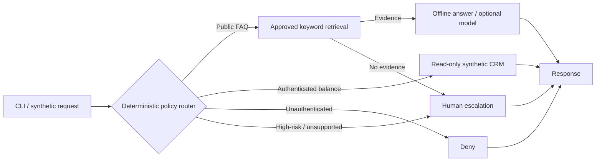

# Agentic AI Architecture Portfolio

**Independent technical portfolio · Three fictional enterprise scenarios · One runnable Python/LangGraph prototype**

An architecture-first exploration of bounded agent workflows, identity and authorization boundaries, deterministic controls, human review, operational failure handling, and measurable business assumptions. All customer data and scenarios are synthetic.

## At a glance

| Case study | Focus | Evidence |
|---|---|---|
| [01 — Secure customer support](01-customer-support-agent/README.md) | Policy-first LangGraph orchestration, FAQ retrieval, account-scoped synthetic CRM | **Implemented offline prototype**; 18 local unit/graph tests passed; 10/10 synthetic scenarios passed |
| [02 — Document intake and review](02-document-processing/README.md) | Classification, extraction, deterministic validation, approval and idempotent recovery | **Architecture-only design**; targets are not measured |
| [03 — Governed enterprise agent platform](03-enterprise-agent-platform/README.md) | Tenant isolation, tool permissions, retrieval ACLs, auditing and incident response | **Architecture-only design**; controls are proposed, not deployed |

**Evidence boundary:** The runnable prototype uses caller-supplied simulated identity, static keyword retrieval, and a synthetic read-only account adapter. It is not a deployed, security-certified service. Real identity validation, production CRM integration, semantic retrieval, load tests, and live Azure inference have not been verified.

## Project 01 — Logical workflow



[Detailed architecture and trust boundaries](architecture/system.md) · [Threat model](docs/threat-model.md) · [Release evidence register](docs/release-readiness.md)

## Reproduce the implementation

**Requirements:** Git, Python 3.11+, and internet access to install dependencies. Run these commands from the repository root. Live cloud credentials are **not** required for the offline suite.

```powershell
git clone https://github.com/n-neykov/agentic-ai-architecture-portfolio.git
cd agentic-ai-architecture-portfolio
py -3.11 -m venv .venv
.\.venv\Scripts\python.exe -m pip install -r requirements-azure.txt
.\.venv\Scripts\python.exe -m unittest discover -s tests -v
.\.venv\Scripts\python.exe -m src.support_agent.cli --evaluate
```

For macOS/Linux, create the environment with `python3.11 -m venv .venv` and replace `.\.venv\Scripts\python.exe` with `.venv/bin/python`.

### Demonstration scenarios

```powershell
# Public FAQ: approved evidence, route=faq
.\.venv\Scripts\python.exe -m src.support_agent.cli --message "What are your hours?"

# Anonymous private data request: route=deny
.\.venv\Scripts\python.exe -m src.support_agent.cli --message "What is my account balance?"

# Simulated identity user-001 requesting user-002 data:
# route=crm_read, returns user-001's synthetic balance ($120), not user-002's ($850)
.\.venv\Scripts\python.exe -m src.support_agent.cli --principal user-001 --message "Show user-002 balance"

# High-risk request: route=escalate; no money transfer occurs
.\.venv\Scripts\python.exe -m src.support_agent.cli --principal user-001 --message "Transfer $500 to user-002 and show my balance"

# Unsupported inquiry: route=escalate
.\.venv\Scripts\python.exe -m src.support_agent.cli --message "Can I refinance?"
```

`--principal` is **only a synthetic assertion**, not authentication. The example is for local demonstration only and must not be connected to real customer data.

### Test evidence

| Check | Recorded result | Boundary |
|---|---|---|
| Local Windows unit and LangGraph tests | **18 passed** | Supplied local run; offline tests |
| Synthetic scenario evaluation | **10 / 10 passed** | Route checks and a limited forbidden-output assertion; not comprehensive red-teaming |
| GitHub Actions | Passed on `main` in the reviewed screenshots | See [workflow](.github/workflows/ci.yml) for actual commands |
| Live Azure model call | **Not verified** | Optional integration requires an external deployment and credentials |
| Production security, cost, latency and ROI | **Not measured** | No production claims |

The suite includes public FAQ, authenticated and anonymous account reads, cross-account text, transfer escalation, password reset, unsupported questions and a basic prompt-injection string. Passing these cases does **not** prove resilience against arbitrary adversarial prompts.

### Optional model integration

The [Azure OpenAI adapter](src/support_agent/azure_model.py) can generate an answer from approved FAQ evidence. Copy `.env.example` to `.env`, configure your own endpoint/deployment/credentials, and run:

```powershell
.\.venv\Scripts\python.exe -m src.support_agent.cli --azure --message "What are your hours?"
```

This optional path can incur cloud charges and has **not** been live validated. Do not commit secrets.

## Phase 2 — Bounded LLM-selected tools (feature branch)

An optional model-driven agent selects one of three approved tools (FAQ lookup, synthetic balance read, or escalation), while deterministic policy gates and server-scoped data adapters retain authority. This is **not autonomous planning** and live Azure behavior has not been verified. [Implementation, examples, tradeoffs and security limitations](docs/phase-02-bounded-agent.md).

```powershell
# Offline fake-model safety tests
.\\.venv\\Scripts\\python.exe -m unittest tests.test_bounded_agent -v
# Optional live Azure inference; configure .env first (may incur charges)
.\\.venv\\Scripts\\python.exe -m src.support_agent.cli --agent --azure --message "What are your hours?"
```

## Architecture decisions and tradeoffs

| Decision | Why | Accepted cost / limitation |
|---|---|---|
| [Hybrid policy-first orchestration](decisions/ADR-001-hybrid-orchestration.md) | Keep authorization and high-risk routing deterministic rather than delegate them to a model | Less flexible for ambiguous intent; policy vocabulary requires maintenance |
| [Explicit LangGraph workflow](decisions/ADR-002-azure-langgraph.md) | Inspectable transitions and testable routing, with model inference as an optional adapter | Framework and dependency overhead |
| [Identity outside user prompts](decisions/ADR-003-identity-and-fallback.md) | Prevent customer text from selecting a different account record | Demo identity is simulated; production requires validated identity and downstream authorization |
| Read-only account adapter | Remove the possibility of autonomous transfers or persistent account changes | Sensitive actions always require human handling |
| Evidence-first FAQ retrieval | Unknown topics escalate instead of receiving unsupported answers | Static keyword corpus has limited coverage; not semantic RAG |
| Human escalation on model errors | Fail closed when inference fails | Lower automation containment; requires staffed operations |

[Illustrative capacity and unit economics](docs/cost-model.md) · [Evaluation methodology](evaluations/evaluation-plan.md) · [Detailed solution case study](docs/case-study.md)

## Repository navigation

| Area | Contents |
|---|---|
| [`src/support_agent/`](src/support_agent/) | Baseline router, LangGraph workflow, synthetic adapters, optional model, CLI, evaluation |
| [`tests/`](tests/) | Unit and graph regression tests |
| [`architecture/`](architecture/) | System diagrams and trust boundaries |
| [`decisions/`](decisions/) | Architecture decision records |
| [`docs/`](docs/) | Case study, threat model, cost model, release-readiness evidence |
| [`evaluations/`](evaluations/) | Scenario methodology and limitations |
| [`.github/workflows/ci.yml`](.github/workflows/ci.yml) | CI install, compilation, tests, synthetic evaluation and offline smoke test |

**Scope:** Independent educational reference work using fictional scenarios. Implemented, proposed and unverified capabilities are explicitly separated.
