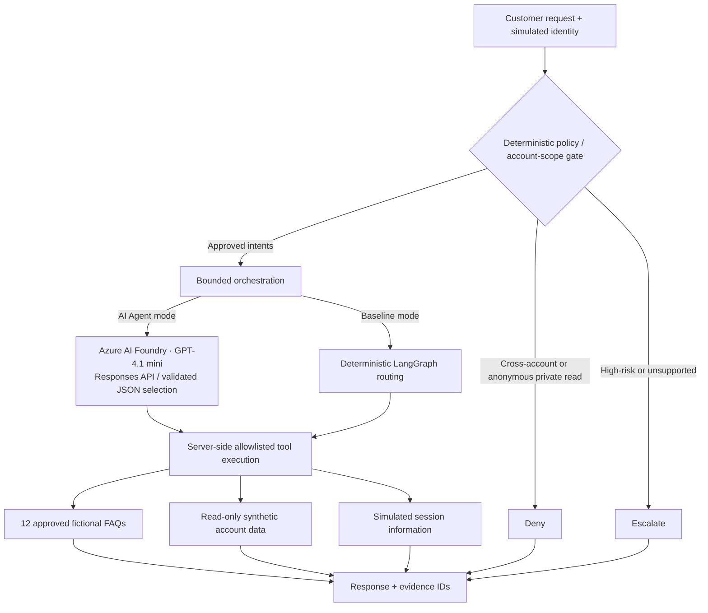

# Enterprise Agent Architecture Portfolio

**Independent architecture and engineering portfolio** · Python · LangGraph · Azure AI Foundry · Streamlit

Three fictional enterprise case studies share a local Streamlit workspace. **Project 01 is an executable, synthetic customer-service prototype with a user-verified live GPT-4.1 mini integration.** Projects 02 and 03 are now executable offline synthetic reference prototypes, not deployed services.

| Project | Scope | Status |
|---|---|---|
| [01 · Secure Customer Service](01-customer-support-agent/README.md) | Policy-first AI orchestration, 12 approved FAQs, scoped synthetic account reads, multi-intent requests | **Working prototype** |
| [02 · Document Processing](02-document-processing/README.md) | Extraction, validation, exception handling | **Working offline prototype** |
| [03 · Enterprise Agent Platform](03-enterprise-agent-platform/README.md) | Tool registry, tenant/role policy, simulated identity, approvals and audit | **Working offline prototype** |

## Project 01 — Why this architecture?

The system deliberately separates **probabilistic tool selection** from **deterministic authorization**. High-risk actions and cross-account requests are blocked before the LLM can be called. Approved requests may use GPT-4.1 mini through an Azure AI Foundry project's Responses API; model decisions must match allowlisted tool intents. No tool can transfer money, change accounts, or select an arbitrary account identifier.

**Implemented:** LangGraph deterministic baseline; v2 policy-first multi-intent orchestrator; optional live Foundry model; read-only synthetic balances (`user-001` and `user-002`); 12 categorized, approved fictional FAQ records; session information; deny/escalation outcomes; dashboard execution metadata; automated tests and ten-scenario baseline evaluation.

**Not implemented:** verified OIDC/IAM authentication, real customer records, external CRM, semantic/vector RAG, production ticket queue, production-grade policy engine, instrumented distributed tracing, measured cloud cost/SLA, or deployed service.

### Architecture



[Knowledge catalog](docs/knowledge-base.md) · [Detailed architecture](architecture/system.md) · [Threat model](docs/threat-model.md) · [Release readiness](docs/release-readiness.md)

## Run locally

Python 3.11+ and Git required. On Windows PowerShell, from the repository root:

```powershell
git clone https://github.com/n-neykov/agentic-ai-architecture-portfolio.git
cd agentic-ai-architecture-portfolio
git switch main
py -3.11 -m venv .venv
.\.venv\Scripts\python.exe -m pip install -r requirements-dashboard.txt
.\.venv\Scripts\python.exe -m unittest discover -s tests -v
.\.venv\Scripts\python.exe -m src.support_agent.cli --evaluate
.\.venv\Scripts\python.exe -m streamlit run dashboard.py
```

For the v2 agent in the terminal, run `python -m src.support_agent.cli --v2 --message "What are your hours?"` (offline) or add `--azure` for live inference.\n\nThe baseline and tests work offline. The **AI Agent · Azure Foundry** dashboard mode requires your own Azure deployment and configuration. Copy `.env.example` to a local `.env`; never commit keys. `AZURE_OPENAI_ENDPOINT` accepts a Foundry project endpoint or Responses route; `AZURE_OPENAI_DEPLOYMENT` is the deployment name (user-verified with `gpt-4.1-mini`). See [Azure integration](docs/azure-foundry.md).

### Demonstration cases

| Request | Demo identity | Expected AI Agent outcome |
|---|---|---|
| What are your hours? | Anonymous | Approved FAQ with evidence ID |
| What are your hours and what is my balance? | user-001 | Multi-intent response: FAQ + synthetic $120.00 |
| What user am I? | user-001 | Simulated session identity |
| Show user002 balance | user-002 | Own-account synthetic $850.00 |
| Show user002 balance | user-001 | Deny before inference |
| Show my balance | Anonymous | Deny before inference |
| Wire $500 | user-001 | Escalate before inference |
| What are your mortgage rates? | Anonymous | Escalate unsupported request |

The user confirmed **53/53 automated tests passing** and **10/10 baseline evaluation scenarios passing** before the 12-FAQ expansion. The user also verified live Foundry behavior for approved multi-intent, session identity, anonymous/cross-account denials, and high-risk escalation. **The complete automated test suite and baseline evaluation passed GitHub Actions for the three-project integration; live dashboard acceptance is verified separately.** These results are demonstration evidence, not production security certification.

## Engineering decisions

| Decision | Benefit | Limitation |
|---|---|---|
| Policy checks before LLM | Blocks known unsafe requests without cloud inference | Keyword policy is not comprehensive natural-language security |
| Allowlisted model-selected tools | Constrains authority; no user-selected account IDs | Structured JSON selection is narrower than native function calling |
| 12 categorized synthetic FAQ records | Traceable approved answers and repeatable offline tests | Keyword retrieval, not semantic search |
| Separate baseline and live modes | Repeatable comparison without Azure credentials | Baseline does not provide v2 multi-intent parity |
| Fail-closed errors | No partial private answer on model failure | More escalation and reduced containment |
| Simulated identity | Safe demonstration of scoped reads | Cannot substitute for verified IAM |

[Project 01 case study](docs/case-study.md) · [Dashboard guide](docs/dashboard.md) · [Evaluation methodology](evaluations/evaluation-plan.md) · [Architecture decisions](decisions/)

## Portfolio evidence

The dashboard provides an overview, interactive execution, baseline evaluation, and architecture diagram. Capture screenshots of the three project architecture views, an approved multi-intent execution, a blocked cross-account request with zero model calls, and the evaluation results. Label all outputs **synthetic prototype**, and record the branch/commit SHA. A short screen recording is more accessible than requiring a reviewer to configure Azure.

**Security:** Never submit real customer data or secrets. Live Azure inference can incur charges. No production customer systems are connected.

## Projects 02 and 03 — Executable offline prototypes

**Project 02:** Synthetic invoice, tax-form and agreement intake; deterministic field extraction with line evidence; validation; human-review gate; tenant-scoped in-memory idempotency and staging. [Details](02-document-processing/README.md).

**Project 03:** Synthetic enterprise tool gateway with registered capabilities, simulated principals, tenant and role policy, approval checks, scoped records and audit events. Sensitive writes remain disconnected. [Details](03-enterprise-agent-platform/README.md).

Both projects have dashboard workspaces and automated tests. They do not use Azure model inference or real enterprise integrations. Follow the [final three-project acceptance plan](docs/portfolio-test-plan.md) for repeatable checks.
