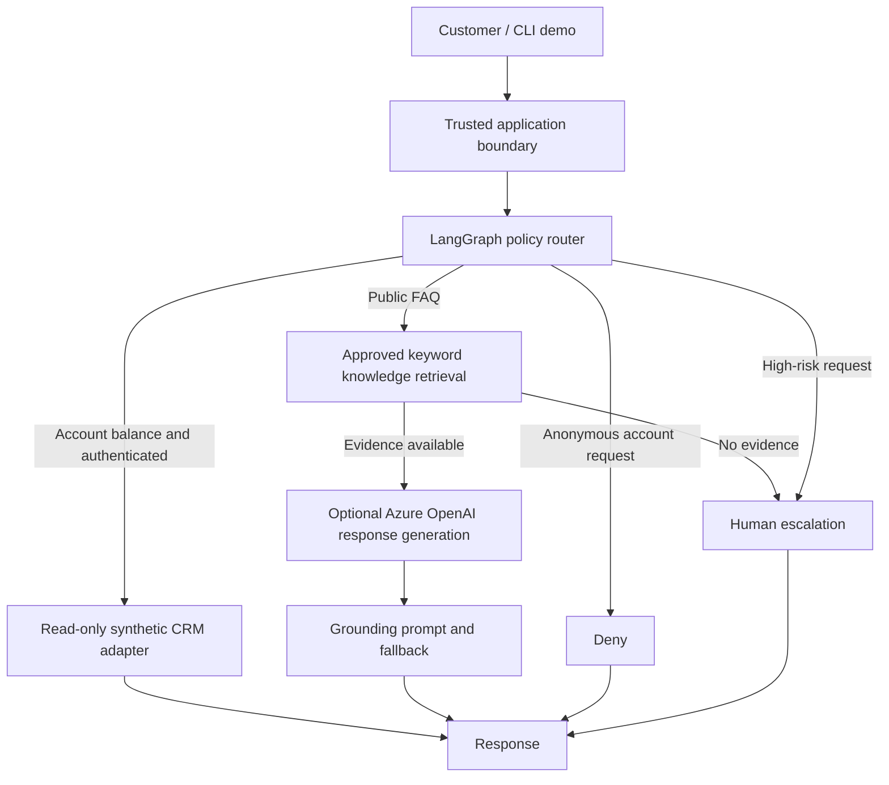

# Logical architecture

## Trust boundaries
1. **Customer input is untrusted.** Customer identifiers in messages cannot choose the CRM record.
2. **Demo context is a simulation.** `TrustedContext` is not a verified identity token. In production it must be created from validated OIDC identity provider claims.
3. **CRM authorization remains outside the LLM.** The model cannot invoke a tool with an arbitrary account ID.
4. **Retrieved content is untrusted data.** Prompt instructions within documents must not be executed; current grounding prompt is insufficient alone for production assurance.
5. **No mutation tools.** Transfers and sensitive account changes are escalated.

## Failure handling
Missing FAQ evidence and model exceptions result in escalation. No autonomous retries of financial transactions exist because transactional tools are not exposed.

## Planned enterprise extensions
OIDC identity provider token validation; external tenant-aware CRM authorization; Azure AI Search; redacted distributed traces; deployment pipelines; evaluation and load testing.
