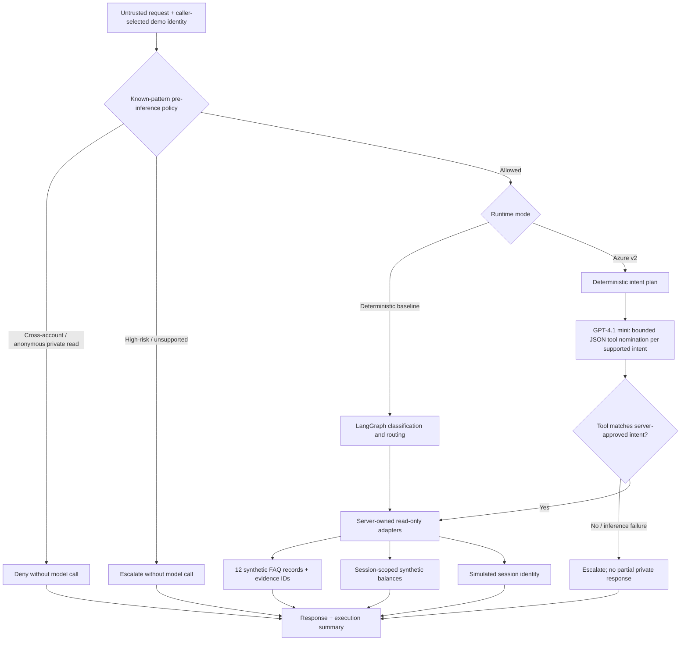

# Project 01 — Implemented logical architecture

## Trust boundaries

1. **Untrusted customer input:** text never supplies authority or selects the account record.
2. **Simulated identity:** `TrustedContext` comes from the demo UI; it is not a validated OIDC/JWT claim. Production IAM is absent.
3. **Deterministic veto:** recognized high-risk, cross-account, and anonymous private-data requests are blocked before model inference. Keyword checks do not cover every paraphrase or adversarial attack.
4. **Bounded model role:** For eligible public/account intents, Azure GPT-4.1 mini proposes one of `faq_lookup`, `account_balance`, or `escalate` as strict JSON. Session identity is handled deterministically. Multi-intent v2 requests can involve separate model nominations using canonical per-intent prompts. The application validates the decision and owns the tool arguments and execution.
5. **Data plane:** synthetic FAQ and account fixtures are read-only. There are no payment or account-write tools.
6. **Failures:** missing evidence, invalid model output, or model outage leads to escalation. Escalation is a response, not a real ticket queue.
7. **Evidence:** v2 returns policy/tool steps; the dashboard execution path is a summary, not distributed tracing or per-node LangGraph telemetry.

## Azure integration

The Foundry project endpoint accepts `/api/projects/<project>/openai/v1/responses`; the adapter normalizes it to the SDK `/openai/v1/` base URL and invokes `responses.create` with `store=False`. It also supports legacy Azure OpenAI resource endpoints via `AzureChatOpenAI`. Credentials come from environment variables in local `.env`. No credentials are committed. [Setup and evidence](../docs/azure-foundry.md).

## Production extension requirements

Verified Entra ID/OIDC tokens, downstream tenant-aware authorization, approved knowledge ingestion and ACLs, robust intent/policy validation, human-review integration, audit-grade redacted traces, secrets management, rate limits, threat testing, and measured performance/cost are **not implemented**.
