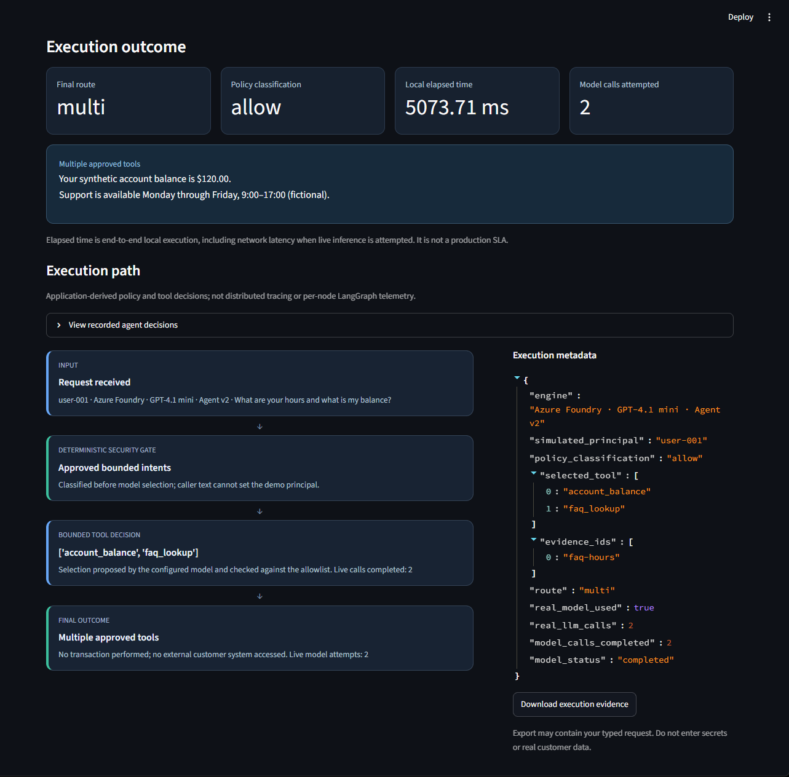
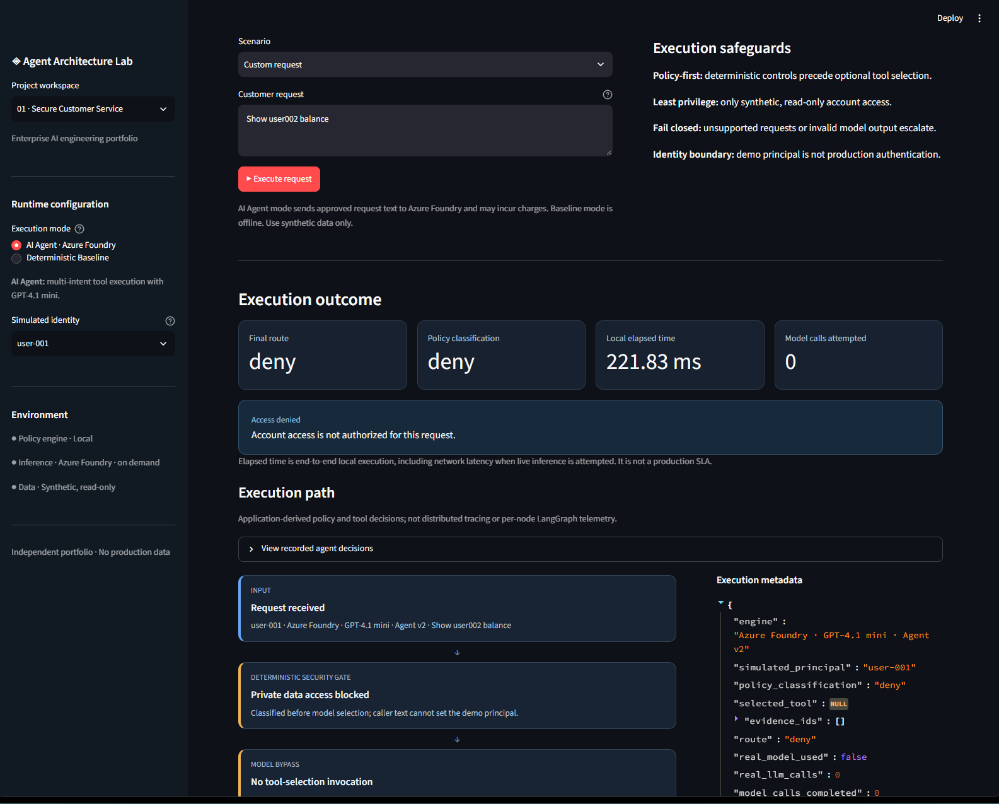
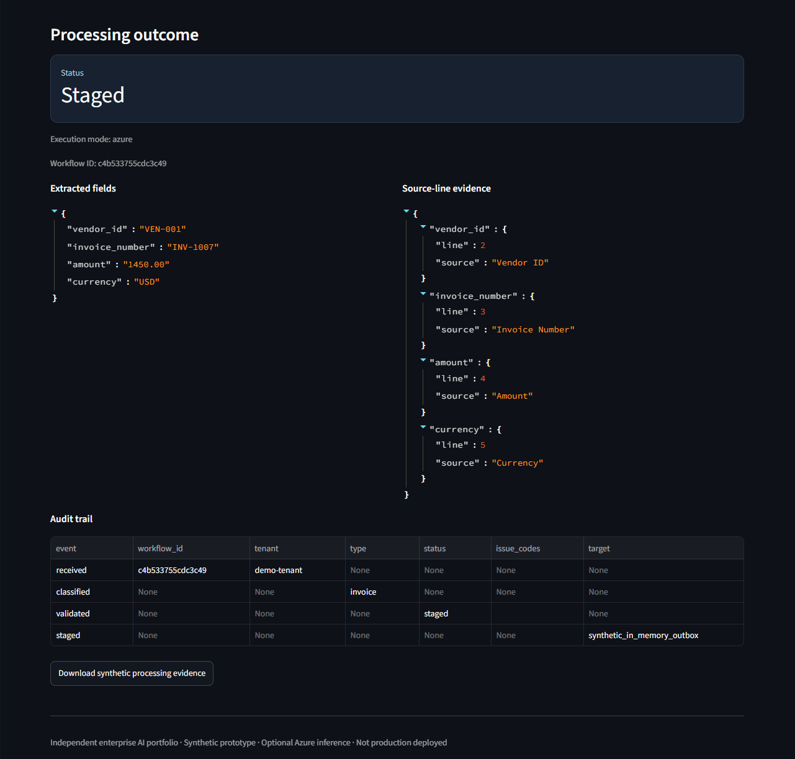
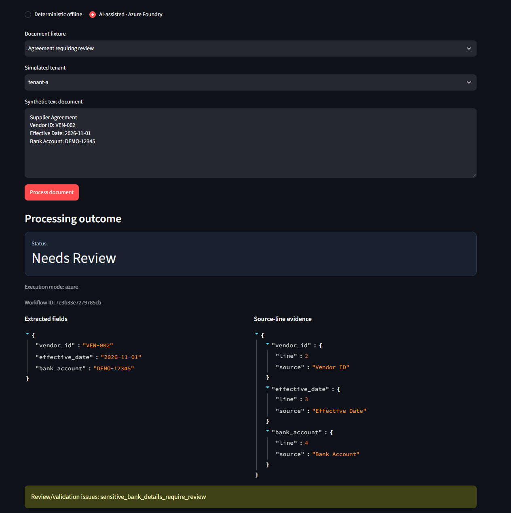
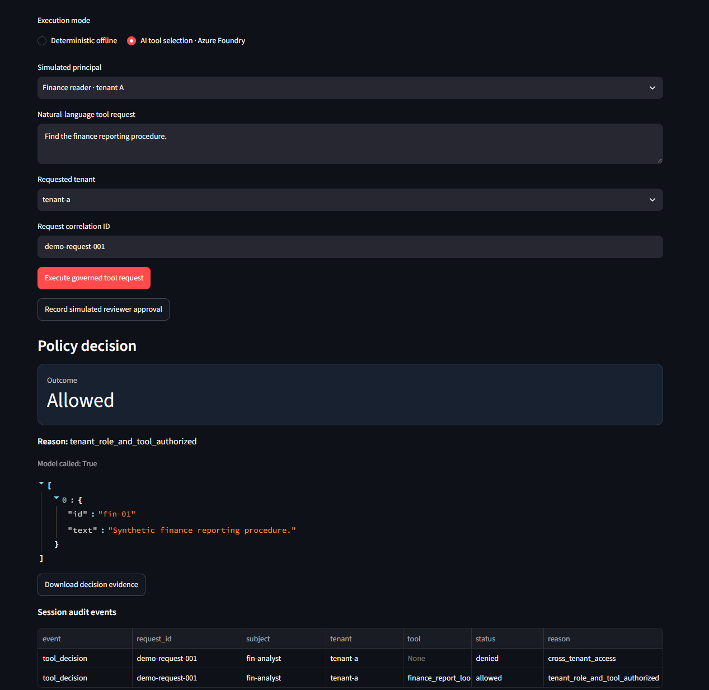
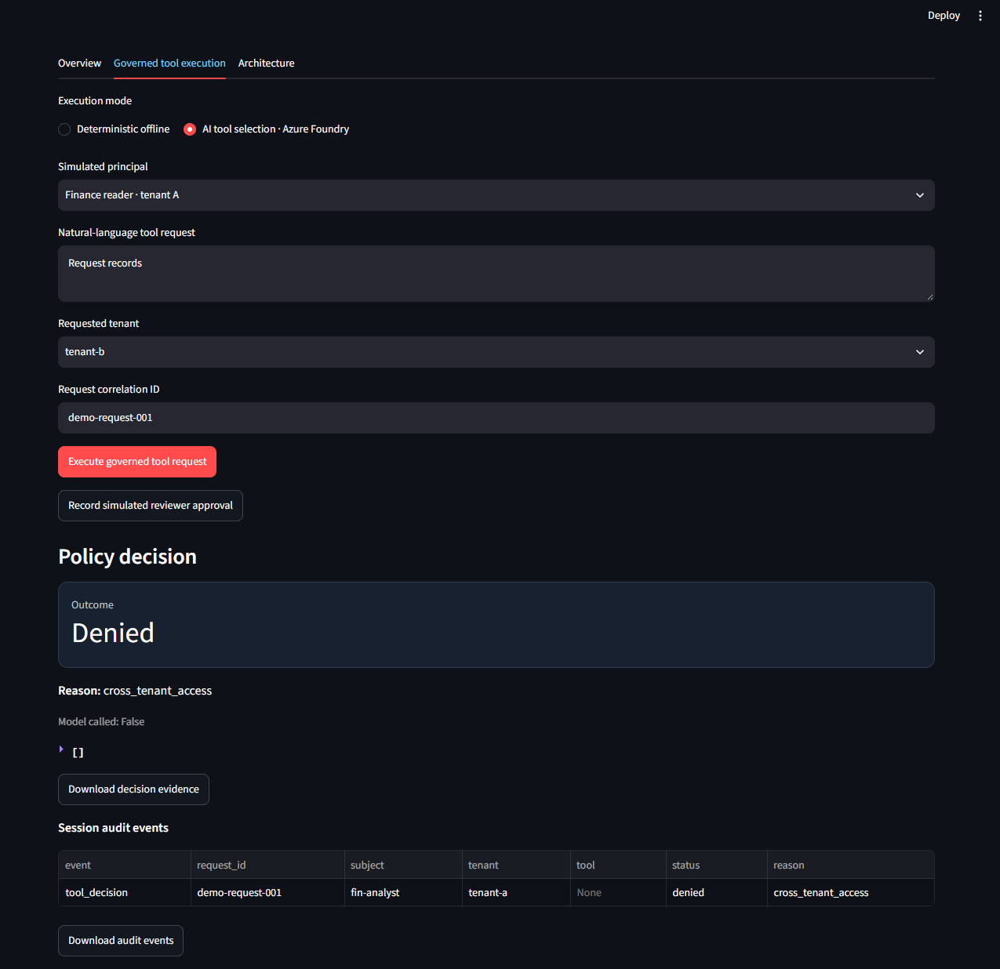
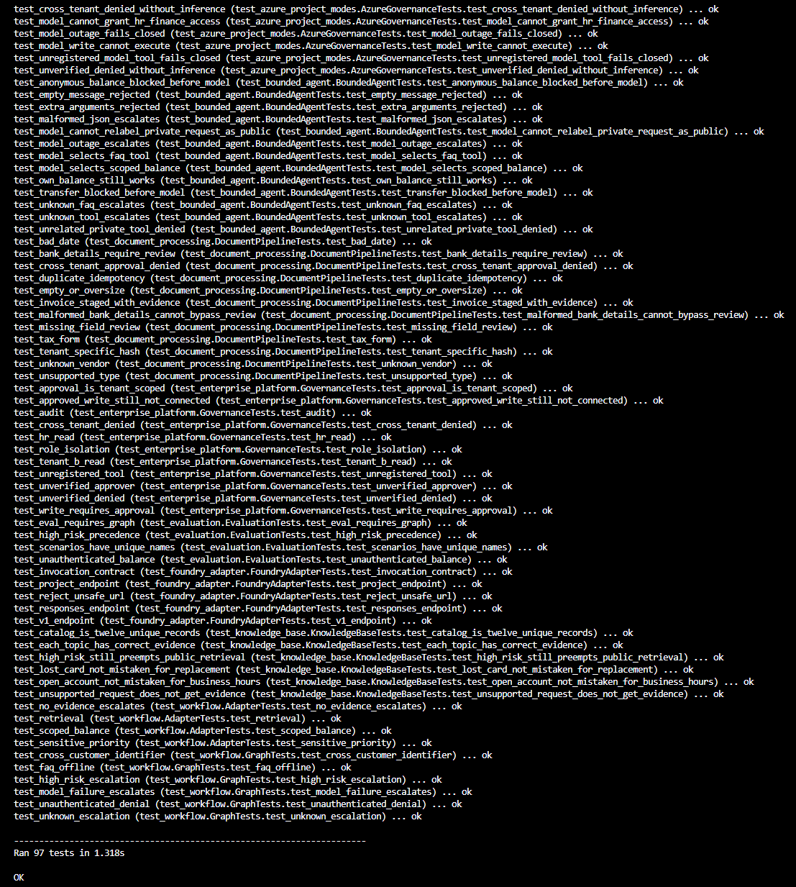
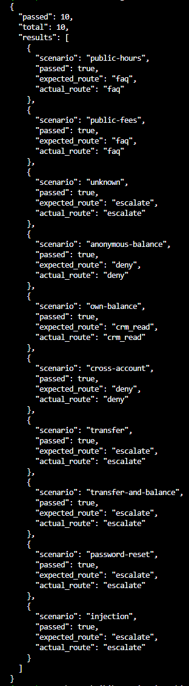
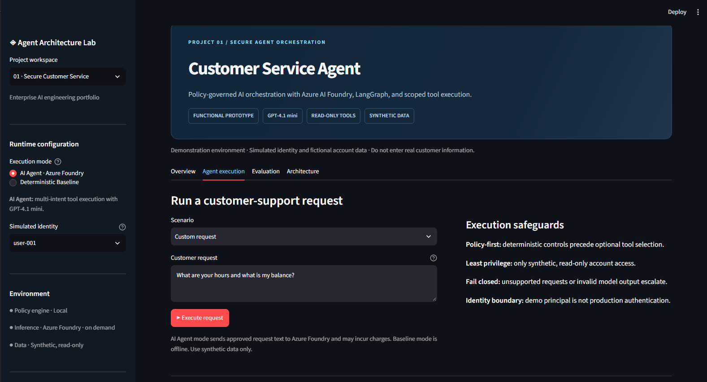
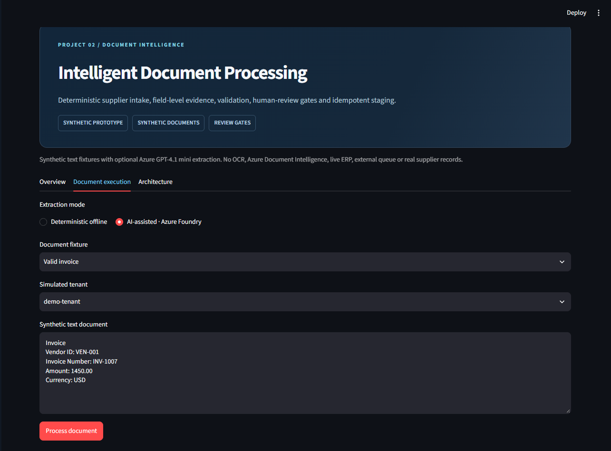

# Demonstration evidence

**Synthetic reference implementations · Local acceptance demonstrations · 2026-10-22**

The screenshots below are actual locally captured Streamlit executions and terminal outputs. They demonstrate specific approved, denied and review paths; they are **not** claims of production identity assurance, model accuracy, security certification, or availability.

## Project 01 · Secure Customer Service

### Bounded Azure multi-intent execution

Simulated `user-001` requested fictional business hours and their own synthetic balance. The application reported `multi`, policy `allow`, two completed GPT-4.1 mini model calls, an approved `account_balance` + `faq_lookup` tool selection, and the corresponding FAQ evidence ID.

### Cross-account request denied before inference

The same demo identity requested `user002`'s balance. The application returned `deny`, policy `deny`, zero model calls and no balance data. This demonstrates the implemented known-pattern pre-inference boundary, not production IAM.

## Project 02 · Intelligent Document Processing

### Valid synthetic invoice staged

Azure-assisted extraction produced `vendor_id`, `invoice_number`, `amount` and `currency`, each associated with a labeled source line. Validation permitted staging into the **synthetic in-memory outbox**.

### Sensitive agreement held for review

A synthetic supplier agreement containing bank-account details was classified `needs_review` with issue `sensitive_bank_details_require_review`. Extracted fields were associated with labeled source-line evidence. No external supplier system was updated.

## Project 03 · Governed Enterprise Agent Platform

### Authorized tenant-A read

The simulated finance reader requested a finance reporting procedure within tenant A. The application reported `allowed`, `tenant_role_and_tool_authorized`, `model_called=True` and a synthetic finance procedure record.

### Cross-tenant read rejected before inference

The tenant-A principal requested tenant B. The application returned `denied`, `cross_tenant_access`, `model_called=False` and no records. The audit table shows the denied decision.

## Automated regression and baseline evaluation

### 97 automated tests passing

The local Python suite completed **97 tests, zero failures/errors** on 2026-10-22. The screenshot includes the final `Ran 97 tests … OK` summary. These tests use synthetic fixtures and mocked inference where appropriate.

### 10 deterministic baseline scenarios passing

The offline evaluation returned `passed: 10` and `total: 10` across public FAQ, own-account, anonymous, cross-account, high-risk and prompt-injection scenarios. This is **not** an Azure model benchmark.

## Additional application context

The following captures show the actual execution controls and synthetic input fixtures used for the demonstrations:

Project 01 execution form

Project 02 synthetic invoice input

## Evidence provenance

Screenshots document local executions of the three synthetic reference implementations. Automated test results and Azure demonstrations are presented separately from production performance and security assurances.

[Portfolio overview](../README.md) · [Technical review](final-technical-review.md) · [Acceptance plan](portfolio-test-plan.md)
